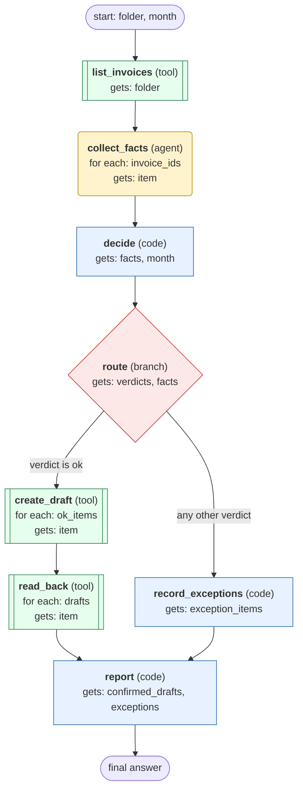

# invoice-matching workflow

Match one folder of supplier invoices to purchase orders and deliveries, create draft bills for the ones that pass, and report the rest.

**Context rule:** fresh context per node; only the declared inputs are passed.

Legend: rounded = AI agent node, double-bordered = tool call, square = code, diamond = branch.

## What each node receives

| Node | Type | Receives (only this) | Tools allowed | Produces | Checks |
|---|---|---|---|---|---|
| list_invoices | tool | folder | list_invoices | invoice_ids | schema, non_empty |
| collect_facts | agent | one item of `invoice_ids` | get_invoice, get_purchase_order, get_deliveries | facts | schema, grounded_in_tool_results |
| decide | code | facts, month | - | verdicts | schema, one_verdict_per_invoice |
| route | branch | verdicts, facts | - | ok_items, exception_items | - |
| create_draft | tool | one item of `ok_items` | create_draft_bill | drafts | schema |
| read_back | tool | one item of `drafts` | get_draft_bill | confirmed_drafts | readback_matches_total |
| record_exceptions | code | exception_items | - | exceptions | schema |
| report | code | confirmed_drafts, exceptions | - | final_answer | schema, reasons_are_bare_codes |
