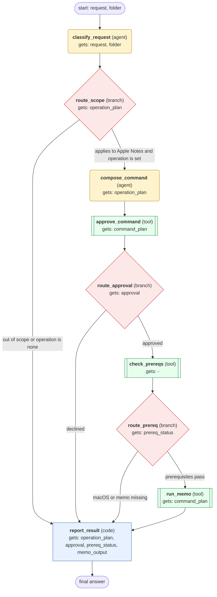

# apple-notes workflow (generated from the apple-notes skill)

Run one Apple Notes operation through the memo CLI after the user approves the exact command, or report why it was not run.

## What each node receives

| Node | Type | Receives (only this) | Tools allowed | Produces | Checks |
|---|---|---|---|---|---|
| classify_request | agent | request, folder | - | operation_plan | schema, non_empty |
| route_scope | branch | operation_plan | - | operation_plan | - |
| compose_command | agent | operation_plan | - | command_plan | schema, memo_command_is_documented, interactive_flag_matches |
| approve_command | tool | command_plan | clarify | approval | approval_recorded |
| route_approval | branch | approval | - | approval | - |
| check_prereqs | tool | - | terminal | prereq_status | prereq_macos_memo_present |
| route_prereq | branch | prereq_status | - | prereq_status | - |
| run_memo | tool | command_plan | terminal | memo_output | grounded_in_tool_results, exit_code_zero |
| report_result | code | operation_plan, approval, prereq_status, memo_output | - | final_answer | schema, non_empty |
