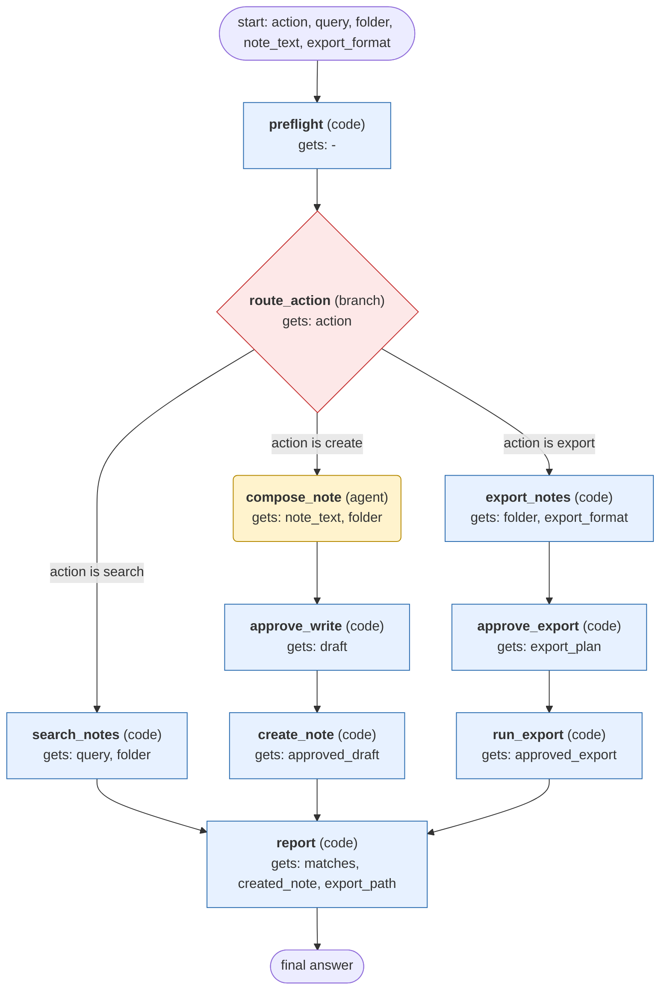

# apple-notes workflow (generated from the apple-notes skill)

Search, create, or export Apple Notes through the memo CLI on macOS, with human approval before any note is written or exported.

## What each node receives

| Node | Type | Receives (only this) | Tools allowed | Produces | Checks |
|---|---|---|---|---|---|
| preflight | code | - | - | env_ok | schema, env_ok_is_true |
| route_action | branch | action | - | route | schema |
| search_notes | code | query, folder | - | matches | schema |
| compose_note | agent | note_text, folder | - | draft | schema, grounded_in_input |
| approve_write | code | draft | - | approved_draft | human_approved |
| create_note | code | approved_draft | - | created_note | schema, readback_matches_title |
| export_notes | code | folder, export_format | - | export_plan | schema, format_is_html_or_markdown |
| approve_export | code | export_plan | - | approved_export | human_approved |
| run_export | code | approved_export | - | export_path | schema, path_exists |
| report | code | matches, created_note, export_path | - | final_answer | schema |
