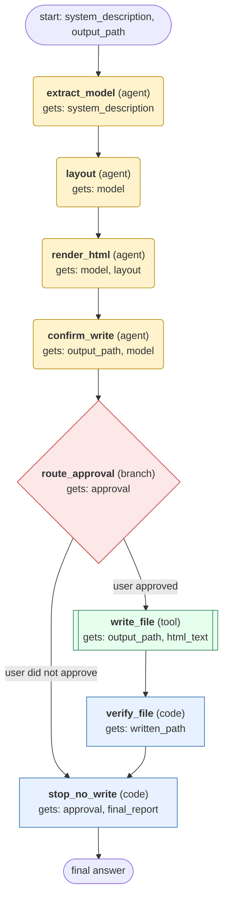

# architecture-diagram workflow (generated from the architecture-diagram skill)

Turn a user's description of a software or cloud architecture into one self-contained dark-themed HTML file with inline SVG, saved to a user-chosen path after the user confirms the layout.

## What each node receives

| Node | Type | Receives (only this) | Tools allowed | Produces | Checks |
|---|---|---|---|---|---|
| extract_model | agent | system_description | - | model | schema, ids_referenced_exist, no_unmentioned_components |
| layout | agent | model | - | layout | schema, no_overlapping_boxes, boundaries_contain_components, min_gap_40px |
| render_html | agent | model, layout | skill_view | html_text | schema, valid_html_document, no_script_tag, legend_below_boundaries |
| confirm_write | agent | output_path, model | - | approval | schema, explicit_user_approval |
| route_approval | branch | approval | - | approved_flag | - |
| write_file | tool | output_path, html_text | write_file | written_path | schema, file_exists_at_path |
| verify_file | code | written_path | - | final_report | schema, svg_present |
| stop_no_write | code | approval, final_report | - | summary | schema |
