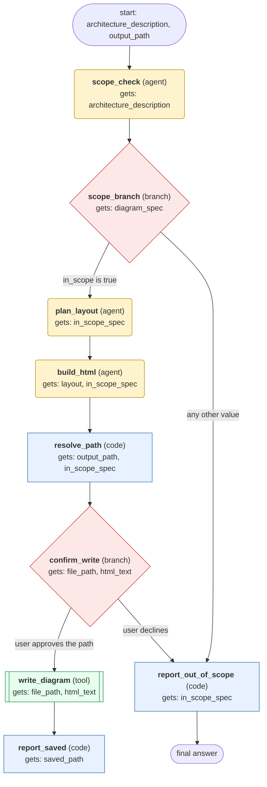

# architecture-diagram workflow (generated from the architecture-diagram skill)

Generate a dark-themed, self-contained HTML file with inline SVG that renders a technical architecture diagram from the user's description of components and connections, then tell the user where it is saved.

## What each node receives

| Node | Type | Receives (only this) | Tools allowed | Produces | Checks |
|---|---|---|---|---|---|
| scope_check | agent | architecture_description | - | diagram_spec | schema, non_empty, scope_is_in_scope |
| scope_branch | branch | diagram_spec | - | in_scope_spec | - |
| plan_layout | agent | in_scope_spec | - | layout | schema, non_empty, no_overlapping_components, legend_below_boundaries, bus_in_gap_between_services |
| build_html | agent | layout, in_scope_spec | skill_view | html_text | schema, non_empty, no_javascript, no_external_resources_except_google_fonts, uses_semantic_colors, legend_outside_boundaries |
| resolve_path | code | output_path, in_scope_spec | - | file_path | schema, non_empty |
| confirm_write | branch | file_path, html_text | - | write_approved | non_empty |
| write_diagram | tool | file_path, html_text | write_file | saved_path | schema, grounded_in_tool_results |
| report_saved | code | saved_path | - | final_answer | schema, non_empty |
| report_out_of_scope | code | in_scope_spec | - | final_answer | schema, non_empty |
