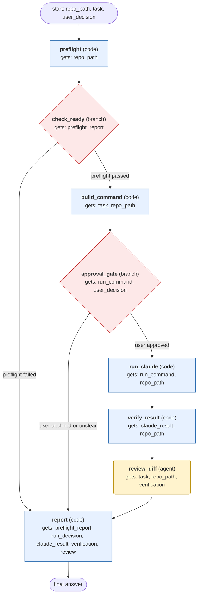

# claude-code-delegation workflow (generated from the claude-code skill)

Run one coding task through the Claude Code CLI in print mode inside a git repo, only after explicit approval, then verify the changes and report what happened.

## What each node receives

| Node | Type | Receives (only this) | Tools allowed | Produces | Checks |
|---|---|---|---|---|---|
| preflight | code | repo_path | - | preflight_report | schema, claude_version_present, auth_status_parsed, is_git_repo |
| check_ready | branch | preflight_report | - | preflight_report | - |
| build_command | code | task, repo_path | - | run_command | schema, print_mode_only, no_skip_permissions_flag, has_max_turns |
| approval_gate | branch | run_command, user_decision | - | run_decision | - |
| run_claude | code | run_command, repo_path | - | claude_result | schema, json_parsed, subtype_reported |
| verify_result | code | claude_result, repo_path | - | verification | schema, git_read_only |
| review_diff | agent | task, repo_path, verification | read_file, search_files | review | schema, grounded_in_tool_results |
| report | code | preflight_report, run_decision, claude_result, verification, review | - | final_answer | schema, absent_steps_marked_not_run, no_claims_beyond_tool_output |
