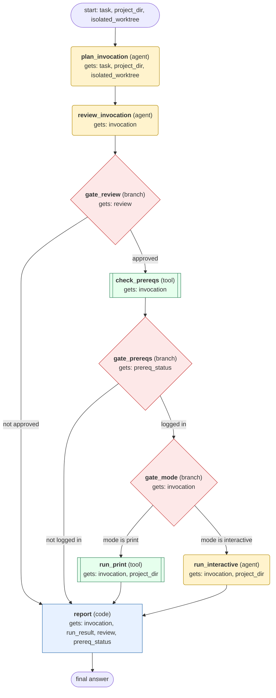

# claude-code-delegation workflow (generated from the claude-code skill)

Delegate one coding task to the Claude Code CLI in a project directory, in print mode for one-shot work or interactive tmux mode for multi-turn work, gated by a command review and a login check, and report the result.

## What each node receives

| Node | Type | Receives (only this) | Tools allowed | Produces | Checks |
|---|---|---|---|---|---|
| plan_invocation | agent | task, project_dir, isolated_worktree | read_file, search_files | invocation | schema, non_empty, no_bypass_flag, has_turn_limit, mode_justified |
| review_invocation | agent | invocation | read_file | review | schema, non_empty, review_covers_flags |
| gate_review | branch | review | - | gate_result | - |
| check_prereqs | tool | invocation | terminal | prereq_status | schema, non_empty, auth_logged_in |
| gate_prereqs | branch | prereq_status | - | prereq_gate | - |
| gate_mode | branch | invocation | - | mode_route | - |
| run_print | tool | invocation, project_dir | terminal | run_result | schema, non_empty, run_result_has_subtype |
| run_interactive | agent | invocation, project_dir | terminal | run_result | schema, non_empty, run_result_has_subtype, prompts_read_before_answer, no_blind_enter |
| report | code | invocation, run_result, review, prereq_status | - | final_answer | schema, reasons_are_bare_codes |
