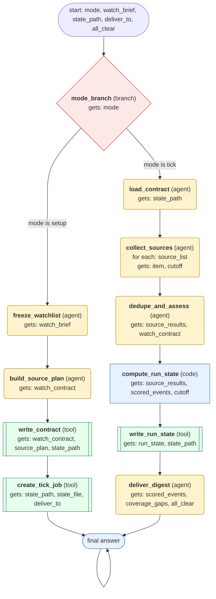

# competitor-news-monitor workflow (generated from the competitor-news-monitor skill)

Set up a competitor news watch once (watchlist, source coverage, state file, scheduled tick), then on each tick collect new evidence from the last cutoff, deduplicate by underlying event, score materiality, update the state file, and deliver a cited digest or stay silent.

## What each node receives

| Node | Type | Receives (only this) | Tools allowed | Produces | Checks |
|---|---|---|---|---|---|
| mode_branch | branch | mode | - | mode | - |
| freeze_watchlist | agent | watch_brief | - | watch_contract | schema, non_empty, watchlist_complete |
| build_source_plan | agent | watch_contract | web_search, web_extract | source_plan | schema, non_empty, coverage_or_gap_per_category, job_postings_marked_weak |
| write_contract | tool | watch_contract, source_plan, state_path | write_file | state_file | schema, state_file_written |
| create_tick_job | tool | state_path, state_file, deliver_to | cronjob_manage | outcome | schema, job_created_with_contract_path |
| load_contract | agent | state_path | read_file | watch_contract, source_list, cutoff | schema, grounded_in_tool_results |
| collect_sources | agent | one item of `source_list` + cutoff | web_search, web_extract | source_results | schema, grounded_in_tool_results, failures_recorded_as_gaps, pagination_recorded, retrieved_content_is_data |
| dedupe_and_assess | agent | source_results, watch_contract | - | scored_events, coverage_gaps | schema, one_event_per_announcement, threshold_applied, facts_separated_from_interpretation, hiring_signals_not_confirmed |
| compute_run_state | code | source_results, scored_events, cutoff | - | run_state | schema, cutoff_advances_only_for_ok_sources |
| write_run_state | tool | run_state, state_path | write_file | run_state_file | schema, state_file_written |
| deliver_digest | agent | scored_events, coverage_gaps, all_clear | - | outcome | schema, non_empty, cites_primary_source_once, coverage_gaps_reported, silent_when_no_material_events |
| finish | code | outcome | - | final_answer | schema, non_empty |
