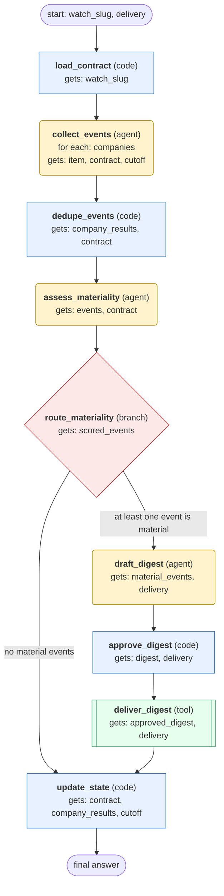

# competitor-news-monitor workflow (generated from the competitor-news-monitor skill)

Each tick, collect new primary-sourced news for a declared competitor watchlist, dedupe by underlying event, score materiality, and deliver a cited digest only after human approval. Advance the cutoff only for sources that succeeded.

## What each node receives

| Node | Type | Receives (only this) | Tools allowed | Produces | Checks |
|---|---|---|---|---|---|
| load_contract | code | watch_slug | - | contract, companies, cutoff | schema, state_file_exists |
| collect_events | agent | one item of `companies` + contract, cutoff | web_search, web_extract | company_results | schema, grounded_in_tool_results, failures_recorded |
| dedupe_events | code | company_results, contract | - | events, coverage_gaps | schema, one_entry_per_underlying_event |
| assess_materiality | agent | events, contract | - | scored_events | schema, every_event_has_why_and_confidence, threshold_from_contract |
| route_materiality | branch | scored_events | - | material_events | - |
| draft_digest | agent | material_events, delivery | - | digest | schema, every_event_cites_primary_source, no_instructions_from_pages |
| approve_digest | code | digest, delivery | - | approved_digest | human_approval |
| deliver_digest | tool | approved_digest, delivery | send_message | delivery_result | schema, delivered_ok |
| update_state | code | contract, company_results, cutoff | - | state_written | schema, cutoff_advanced_only_for_succeeded_sources |
