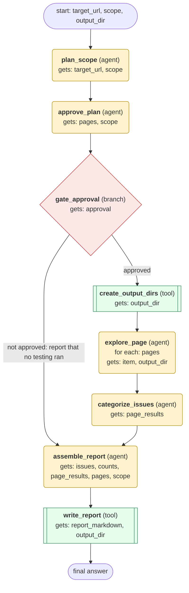

# dogfood workflow (generated from the dogfood skill)

Run systematic exploratory QA of a web app in the browser, de-duplicate and rate the issues, and write a cited bug report to the output directory after the user approves the test plan.

## What each node receives

| Node | Type | Receives (only this) | Tools allowed | Produces | Checks |
|---|---|---|---|---|---|
| plan_scope | agent | target_url, scope | web_extract | pages | schema, non_empty, sitemap_from_fetched_page |
| approve_plan | agent | pages, scope | clarify | approval | schema, approval_recorded |
| gate_approval | branch | approval | - |  | - |
| create_output_dirs | tool | output_dir | terminal | output_dir_ready | screenshots_dir_exists |
| explore_page | agent | one item of `pages` + output_dir | browser_exec | page_results | schema, grounded_in_tool_results, console_hook_registered, interactions_exercised, evidence_saved |
| categorize_issues | agent | page_results | skill_view | issues, counts | schema, issues_deduplicated_sorted |
| assemble_report | agent | issues, counts, page_results, pages, scope | skill_view | report_markdown | schema, non_empty, report_complete |
| write_report | tool | report_markdown, output_dir | write_file | report_path | file_written |
