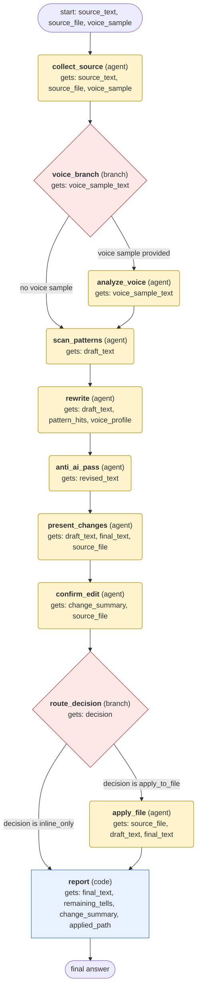

# humanizer workflow (generated from the humanizer skill)

Rewrite user-supplied text to remove AI writing patterns and add a real voice, preserve its meaning, show the rewrite, and apply it to a file only after the user approves.

## What each node receives

| Node | Type | Receives (only this) | Tools allowed | Produces | Checks |
|---|---|---|---|---|---|
| collect_source | agent | source_text, source_file, voice_sample | read_file | draft_text, voice_sample_text | schema, non_empty, grounded_in_tool_results |
| voice_branch | branch | voice_sample_text | - | voice_sample_text | - |
| analyze_voice | agent | voice_sample_text | - | voice_profile | schema, non_empty |
| scan_patterns | agent | draft_text | skill_view | pattern_hits | schema, all_patterns_reported, grounded_in_tool_results |
| rewrite | agent | draft_text, pattern_hits, voice_profile | - | revised_text | schema, non_empty, meaning_preserved, voice_matches_profile, has_personality |
| anti_ai_pass | agent | revised_text | - | final_text, remaining_tells | schema, non_empty, tells_addressed, meaning_preserved |
| present_changes | agent | draft_text, final_text, source_file | - | change_summary | schema, non_empty |
| confirm_edit | agent | change_summary, source_file | clarify | decision | schema |
| route_decision | branch | decision | - | decision | - |
| apply_file | agent | source_file, draft_text, final_text | patch | applied_path | schema, grounded_in_tool_results, diff_matches_final_text |
| report | code | final_text, remaining_tells, change_summary, applied_path | - | final_answer | schema, shows_rewrite |
