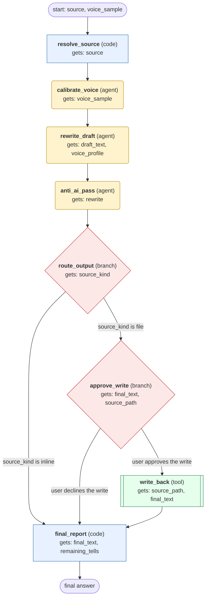

# humanizer workflow (generated from the humanizer skill)

Rewrite a piece of text to remove AI writing patterns and add a natural voice, then return it inline or write it back to its file after approval.

## What each node receives

| Node | Type | Receives (only this) | Tools allowed | Produces | Checks |
|---|---|---|---|---|---|
| resolve_source | code | source | - | draft_text, source_kind, source_path | schema, non_empty |
| calibrate_voice | agent | voice_sample | read_file | voice_profile | schema, grounded_in_tool_results |
| rewrite_draft | agent | draft_text, voice_profile | - | rewrite, changes | schema, meaning_preserved |
| anti_ai_pass | agent | rewrite | - | final_text, remaining_tells | schema, no_new_facts |
| route_output | branch | source_kind | - | route | - |
| approve_write | branch | final_text, source_path | - | human_decision | human_approved_before_write |
| write_back | tool | source_path, final_text | write_file | write_result | schema, readback_matches |
| final_report | code | final_text, remaining_tells | - | final_answer | schema |
