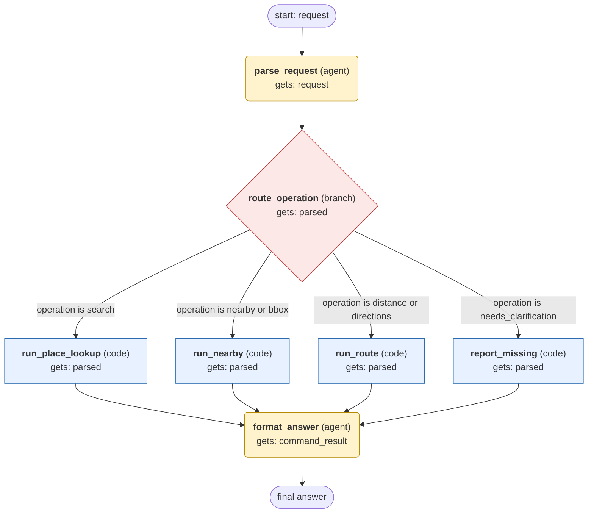

# maps workflow (generated from the maps skill)

Answer one location question (geocode, reverse geocode, nearby places, distance, directions, timezone, area or bounding-box search) with scripts/maps_client.py using free OpenStreetMap data.

## What each node receives

| Node | Type | Receives (only this) | Tools allowed | Produces | Checks |
|---|---|---|---|---|---|
| parse_request | agent | request | - | parsed | schema, required_args_present |
| route_operation | branch | parsed | - | parsed | schema |
| run_place_lookup | code | parsed | - | command_result | schema, exit_code_zero, output_not_empty |
| run_nearby | code | parsed | - | command_result | schema, exit_code_zero, output_not_empty |
| run_route | code | parsed | - | command_result | schema, exit_code_zero, output_not_empty |
| report_missing | code | parsed | - | command_result | schema |
| format_answer | agent | command_result | - | final_answer | schema, grounded_in_command_output |
