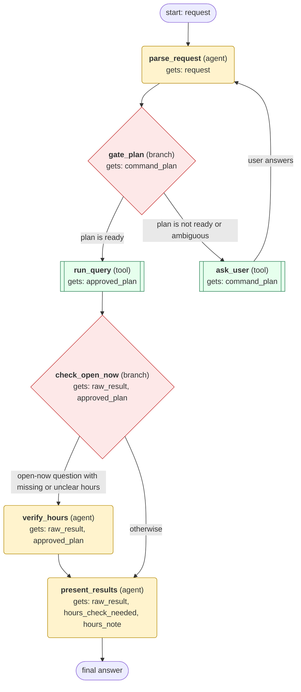

# maps workflow (generated from the maps skill)

Answer a location request (geocode, reverse geocode, nearby places, distance, directions, timezone, or bounding-box POI search) by running the maps_client.py script and presenting the results with map links.

## What each node receives

| Node | Type | Receives (only this) | Tools allowed | Produces | Checks |
|---|---|---|---|---|---|
| parse_request | agent | request | skill_view | command_plan | schema, non_empty, command_in_catalog, args_match_command |
| gate_plan | branch | command_plan | - | approved_plan | - |
| ask_user | tool | command_plan | clarify | clarification | non_empty |
| run_query | tool | approved_plan | terminal | raw_result | schema, exit_code_zero, json_output_parses, coordinates_in_range |
| check_open_now | branch | raw_result, approved_plan | - | hours_check_needed | - |
| verify_hours | agent | raw_result, approved_plan | web_search | hours_note | schema, non_empty, grounded_in_tool_results, hours_verified_or_marked_unknown |
| present_results | agent | raw_result, hours_check_needed, hours_note | - | final_answer | schema, non_empty, grounded_in_tool_results, numbered_list_with_maps_url |
