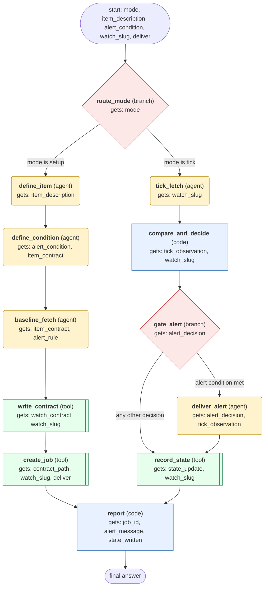

# product-price-monitor workflow (generated from the product-price-monitor skill)

Set up a price watch on one concrete item (baseline fetch, contract file, recurring cron job), and on each scheduled tick re-fetch the item, compare the all-in price and availability with stored state, alert only on a new qualifying condition, and never overwrite the last good observation with an error.

## What each node receives

| Node | Type | Receives (only this) | Tools allowed | Produces | Checks |
|---|---|---|---|---|---|
| route_mode | branch | mode | - | route | mode_is_setup_or_tick |
| define_item | agent | item_description | - | item_contract | schema, non_empty, item_pins_variant |
| define_condition | agent | alert_condition, item_contract | - | alert_rule | schema, non_empty, condition_decides_synthetic_examples |
| baseline_fetch | agent | item_contract, alert_rule | web_extract, browser_exec | watch_contract | schema, non_empty, baseline_fetch_succeeded, baseline_matches_contract |
| write_contract | tool | watch_contract, watch_slug | write_file | contract_path | schema |
| create_job | tool | contract_path, watch_slug, deliver | cronjob_manage | job_id | schema, cadence_respects_site_limits |
| tick_fetch | agent | watch_slug | read_file, web_extract, browser_exec | tick_observation | schema, grounded_in_tool_results |
| compare_and_decide | code | tick_observation, watch_slug | - | alert_decision, state_update | schema, compare_is_deterministic, state_file_preserves_last_good |
| gate_alert | branch | alert_decision | - | route | schema |
| deliver_alert | agent | alert_decision, tick_observation | - | alert_message | schema, non_empty, alert_has_required_fields |
| record_state | tool | state_update, watch_slug | write_file | state_written | schema |
| report | code | job_id, alert_message, state_written | - | final_answer | schema, non_empty |
