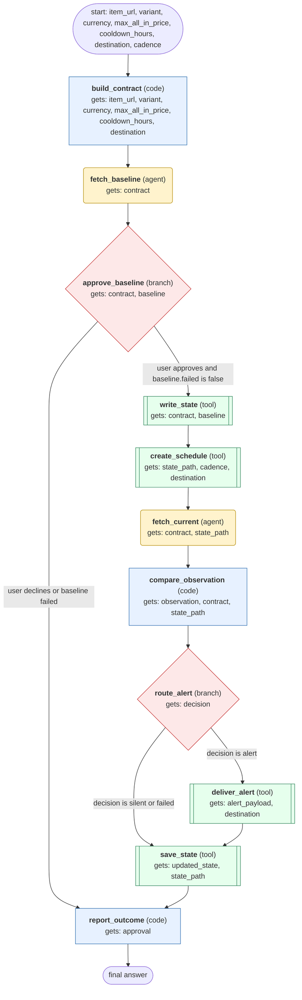

# product-price-monitor workflow (generated from the product-price-monitor skill)

Set up a price watch on one exact item with a verified baseline, then on each tick fetch the price, suppress duplicate alerts, and alert only when the all-in condition is met.

## What each node receives

| Node | Type | Receives (only this) | Tools allowed | Produces | Checks |
|---|---|---|---|---|---|
| build_contract | code | item_url, variant, currency, max_all_in_price, cooldown_hours, destination | - | contract | schema, variant_nonempty, currency_is_iso_code, threshold_positive |
| fetch_baseline | agent | contract | web_extract | baseline | schema, grounded_in_tool_results, variant_matches_contract |
| approve_baseline | branch | contract, baseline | - | approval | - |
| write_state | tool | contract, baseline | write_file | state_path | schema, file_parses_as_json, contract_matches_state |
| create_schedule | tool | state_path, cadence, destination | cronjob_manage | job_id | schema, job_listed_with_cadence |
| fetch_current | agent | contract, state_path | web_extract | observation | schema, grounded_in_tool_results, variant_matches_contract |
| compare_observation | code | observation, contract, state_path | - | decision, alert_payload, updated_state | schema, deterministic_replay, no_overwrite_on_failed_fetch, same_offer_not_realerted_within_cooldown, currency_matches_contract |
| route_alert | branch | decision | - | route_result | - |
| deliver_alert | tool | alert_payload, destination | send_message | delivery | schema, destination_matches_contract, payload_has_all_in_price_currency_timestamp_link, never_claims_reserved_inventory |
| save_state | tool | updated_state, state_path | write_file | saved_state | schema, last_good_not_overwritten_by_error, file_parses_as_json |
| report_outcome | code | approval | - | result | schema |
