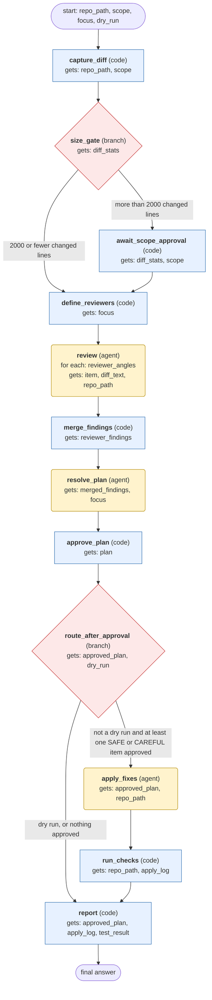

# simplify-code workflow (generated from the simplify-code skill)

Review the user's recent code changes with four parallel narrow reviewers (reuse, quality, efficiency, altitude), resolve their findings into SAFE, CAREFUL and RISKY tiers, apply only the user-approved SAFE and CAREFUL fixes with test verification, and report the rest.

## What each node receives

| Node | Type | Receives (only this) | Tools allowed | Produces | Checks |
|---|---|---|---|---|---|
| capture_diff | code | repo_path, scope | - | diff_text, diff_stats | schema, non_empty_diff |
| size_gate | branch | diff_stats | - | diff_stats | - |
| await_scope_approval | code | diff_stats, scope | - | scope_approved | human_approved |
| define_reviewers | code | focus | - | reviewer_angles | schema, at_most_four_angles |
| review | agent | one item of `reviewer_angles` + diff_text, repo_path | read_file, search_files, terminal | reviewer_findings | schema, evidence_has_file_and_line, findings_grounded_in_search |
| merge_findings | code | reviewer_findings | - | merged_findings | schema, no_duplicate_locations |
| resolve_plan | agent | merged_findings, focus | read_file, search_files, terminal | plan | schema, every_item_has_file_and_line, tier_matches_risk_rule |
| approve_plan | code | plan | - | approved_plan | human_approved, no_risky_item_auto_approved |
| route_after_approval | branch | approved_plan, dry_run | - | approved_plan | - |
| apply_fixes | agent | approved_plan, repo_path | read_file, patch, terminal | apply_log | schema, only_approved_items_touched, no_risky_item_applied |
| run_checks | code | repo_path, apply_log | - | test_result | schema, exit_codes_recorded |
| report | code | approved_plan, apply_log, test_result | - | final_report | schema, every_skipped_item_has_reason |
