# songwriting-and-ai-music workflow (generated from the songwriting-and-ai-music skill)

Turn a song concept (original or parody) into a finished, Suno-ready package: hook, structure, lyrics, meter and phonetic checks, metatags, style prompt, variation plan, and the chosen take.

```mermaid
flowchart TD
  start(["start: concept, original_song_text, target_style"])
  write_hook("<b>write_hook</b> (agent)<br/>gets: concept")
  map_skeleton("<b>map_skeleton</b> (agent)<br/>gets: original_song_text, hook_concept")
  generate_material("<b>generate_material</b> (agent)<br/>gets: hook_concept, skeleton")
  draft_lyrics("<b>draft_lyrics</b> (agent)<br/>gets: hook_concept, skeleton, raw_material, original_song_text")
  meter_pass("<b>meter_pass</b> (agent)<br/>gets: lyrics")
  phonetic_pass("<b>phonetic_pass</b> (agent)<br/>gets: lyrics_metered")
  metatag_pass("<b>metatag_pass</b> (agent)<br/>gets: lyrics_phonetic")
  style_prompt("<b>style_prompt</b> (agent)<br/>gets: hook_concept, target_style, tagged_lyrics")
  variation_plan("<b>variation_plan</b> (agent)<br/>gets: style_field, tagged_lyrics")
  select_take("<b>select_take</b> (agent)<br/>gets: variation_plan")
  final_package("<b>final_package</b> (agent)<br/>gets: hook_concept, tagged_lyrics, style_field, exclude_field, phonetic_respellings, clip_test_flags, selected_take")
  final_package --> finish(["final answer"])
  start --> write_hook
  write_hook --> map_skeleton
  map_skeleton --> generate_material
  generate_material --> draft_lyrics
  draft_lyrics --> meter_pass
  meter_pass --> phonetic_pass
  phonetic_pass --> metatag_pass
  metatag_pass --> style_prompt
  style_prompt --> variation_plan
  variation_plan --> select_take
  select_take --> final_package
  classDef agent fill:#fff3cd,stroke:#b58900;
  classDef code fill:#e7f1ff,stroke:#2b6cb0;
  classDef tool fill:#e6ffed,stroke:#2f855a;
  classDef branch fill:#fde8e8,stroke:#c53030;
  class write_hook,map_skeleton,generate_material,draft_lyrics,meter_pass,phonetic_pass,metatag_pass,style_prompt,variation_plan,select_take,final_package agent;
```

## What each node receives

| Node | Type | Receives (only this) | Tools allowed | Produces | Checks |
|---|---|---|---|---|---|
| write_hook | agent | concept | - | hook_concept | schema, non_empty, hook_identified |
| map_skeleton | agent | original_song_text, hook_concept | - | skeleton | schema, non_empty, skeleton_mapped |
| generate_material | agent | hook_concept, skeleton | - | raw_material | schema, non_empty |
| draft_lyrics | agent | hook_concept, skeleton, raw_material, original_song_text | - | lyrics | schema, non_empty, structure_matches_skeleton, original_lines_kept, bridge_transforms_imagery |
| meter_pass | agent | lyrics | - | lyrics_metered | schema, non_empty, meter_checked |
| phonetic_pass | agent | lyrics_metered | - | lyrics_phonetic, phonetic_respellings, clip_test_flags | schema, non_empty, phonetic_rules_applied, respellings_listed |
| metatag_pass | agent | lyrics_phonetic | - | tagged_lyrics | schema, non_empty, structural_tags_present, tags_per_section_max, no_contradictory_tags, lyrics_under_3000_chars |
| style_prompt | agent | hook_concept, target_style, tagged_lyrics | - | style_field, exclude_field | schema, non_empty, no_artist_names, style_under_1000_chars, describes_dynamic_arc |
| variation_plan | agent | style_field, tagged_lyrics | - | variation_plan | schema, variation_count_3_to_5 |
| select_take | agent | variation_plan | clarify | selected_take | schema, non_empty, accidental_gems_kept |
| final_package | agent | hook_concept, tagged_lyrics, style_field, exclude_field, phonetic_respellings, clip_test_flags, selected_take | - | final_package | schema, non_empty, all_sections_present, respellings_listed |
