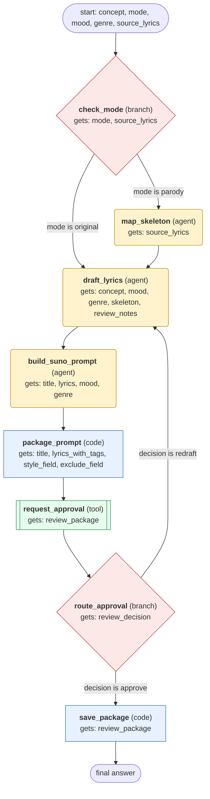

# songwriting-and-ai-music workflow (generated from the songwriting-and-ai-music skill)

Turn a concept (original song or parody of a supplied song) into lyrics with structure tags and a Suno style prompt, get human approval, then save the package.

## What each node receives

| Node | Type | Receives (only this) | Tools allowed | Produces | Checks |
|---|---|---|---|---|---|
| check_mode | branch | mode, source_lyrics | - | route_taken | schema, parody_has_source_lyrics |
| map_skeleton | agent | source_lyrics | - | skeleton | schema, line_count_matches_source |
| draft_lyrics | agent | concept, mood, genre, skeleton, review_notes | - | title, lyrics | schema, lyrics_under_3000_chars, metatags_in_allowed_list, no_artist_names |
| build_suno_prompt | agent | title, lyrics, mood, genre | - | style_field, exclude_field, lyrics_with_tags | schema, style_under_1000_chars, lyrics_under_3000_chars, no_artist_names |
| package_prompt | code | title, lyrics_with_tags, style_field, exclude_field | - | review_package | schema, all_fields_present |
| request_approval | tool | review_package | ask_user | review_decision, review_notes | schema, decision_is_approve_or_redraft_or_drop |
| route_approval | branch | review_decision | - | approval_route | schema |
| save_package | code | review_package | - | saved_path | schema, file_exists_after_write |
