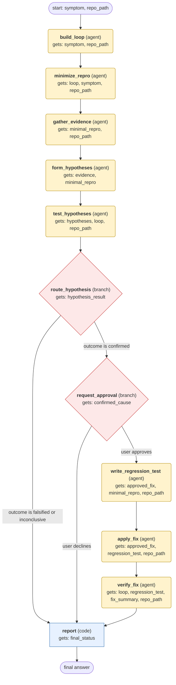

# systematic-debugging workflow (generated from the systematic-debugging skill)

Find the root cause of one bug through a tight red/green feedback loop, confirm it with a minimal test, get user approval, then apply and verify one fix.

## What each node receives

| Node | Type | Receives (only this) | Tools allowed | Produces | Checks |
|---|---|---|---|---|---|
| build_loop | agent | symptom, repo_path | terminal, read_file, search_files | loop | schema, loop_is_red |
| minimize_repro | agent | loop, symptom, repo_path | terminal, read_file | minimal_repro | schema, still_red |
| gather_evidence | agent | minimal_repro, repo_path | terminal, read_file, search_files | evidence | schema, grounded_in_tool_results |
| form_hypotheses | agent | evidence, minimal_repro | read_file, search_files | hypotheses | schema, each_has_prediction |
| test_hypotheses | agent | hypotheses, loop, repo_path | terminal, read_file | hypothesis_result | schema, probes_reverted, at_most_3_probes |
| route_hypothesis | branch | hypothesis_result | - | confirmed_cause, final_status | - |
| request_approval | branch | confirmed_cause | - | approved_fix, final_status | - |
| write_regression_test | agent | approved_fix, minimal_repro, repo_path | read_file, write_file, terminal | regression_test | schema, fails_before_fix |
| apply_fix | agent | approved_fix, regression_test, repo_path | read_file, patch, terminal | fix_summary | schema, single_root_cause_change |
| verify_fix | agent | loop, regression_test, fix_summary, repo_path | terminal | final_status | schema, loop_green, full_suite_green |
| report | code | final_status | - | final_answer | schema |
