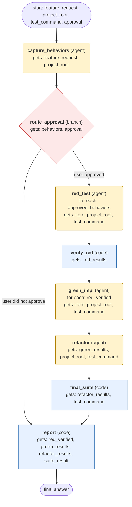

# test-driven-development workflow (generated from the test-driven-development skill)

Implement one feature or bug fix test-first, one behavior at a time (RED, GREEN, REFACTOR), and report verified results.

## What each node receives

| Node | Type | Receives (only this) | Tools allowed | Produces | Checks |
|---|---|---|---|---|---|
| capture_behaviors | agent | feature_request, project_root | read_file, search_files | behaviors | schema, non_empty, no_files_written |
| route_approval | branch | behaviors, approval | - | approved_behaviors | human_approved |
| red_test | agent | one item of `approved_behaviors` + project_root, test_command | read_file, search_files, write_file, terminal | red_results | schema, test_failed_before_code, grounded_in_tool_results |
| verify_red | code | red_results | - | red_verified | schema, every_red_failed_for_missing_feature |
| green_impl | agent | one item of `red_verified` + project_root, test_command | read_file, search_files, patch, terminal | green_results | schema, target_test_passes, full_suite_no_regressions, grounded_in_tool_results |
| refactor | agent | green_results, project_root, test_command | read_file, search_files, patch, terminal | refactor_results | schema, suite_green_after_refactor |
| final_suite | code | refactor_results, test_command | - | suite_result | schema, exit_code_zero |
| report | code | red_verified, green_results, refactor_results, suite_result | - | final_answer | schema |
