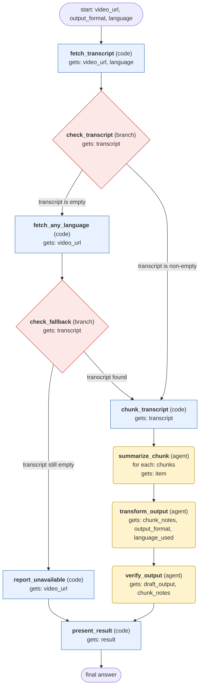

# youtube-content workflow (generated from the youtube-content skill)

Turn one YouTube video's transcript into the requested format (summary by default), or report that no transcript is available.

## What each node receives

| Node | Type | Receives (only this) | Tools allowed | Produces | Checks |
|---|---|---|---|---|---|
| fetch_transcript | code | video_url, language | - | transcript, language_used | schema |
| check_transcript | branch | transcript | - | transcript | schema |
| fetch_any_language | code | video_url | - | transcript, language_used | schema |
| check_fallback | branch | transcript | - | transcript, language_used | schema |
| report_unavailable | code | video_url | - | result | schema |
| chunk_transcript | code | transcript | - | chunks | schema, non_empty |
| summarize_chunk | agent | one item of `chunks` | - | chunk_notes | schema, grounded_in_source |
| transform_output | agent | chunk_notes, output_format, language_used | - | draft_output | schema, grounded_in_source, thread_posts_under_280_chars |
| verify_output | agent | draft_output, chunk_notes | - | result | schema, grounded_in_source |
| present_result | code | result | - | final_answer | schema |
