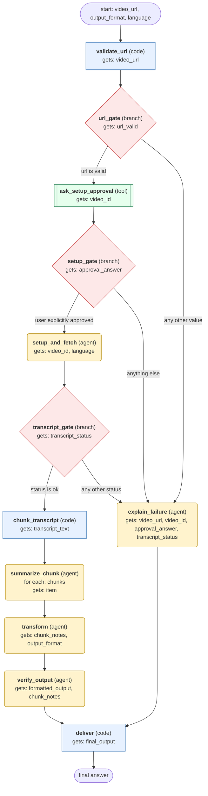

# youtube-content workflow (generated from the youtube-content skill)

Fetch a YouTube video's transcript with the youtube helper, turn it into the requested format (default summary), verify it, and return it. Stop with an explanation if any gate fails.

## What each node receives

| Node | Type | Receives (only this) | Tools allowed | Produces | Checks |
|---|---|---|---|---|---|
| validate_url | code | video_url | - | video_id, url_valid | schema, url_is_youtube |
| url_gate | branch | url_valid | - |  | - |
| ask_setup_approval | tool | video_id | clarify | approval_answer | non_empty, user_approved |
| setup_gate | branch | approval_answer | - |  | - |
| setup_and_fetch | agent | video_id, language | terminal | transcript_text, transcript_language, transcript_status | schema, grounded_in_tool_results, import_check_passed, no_raw_pip |
| transcript_gate | branch | transcript_status | - |  | - |
| chunk_transcript | code | transcript_text | - | chunks | schema, non_empty |
| summarize_chunk | agent | one item of `chunks` | - | chunk_notes | schema, non_empty, timestamps_match_source |
| transform | agent | chunk_notes, output_format | - | formatted_output | schema, non_empty, format_matches_request, timestamps_match_source |
| verify_output | agent | formatted_output, chunk_notes | - | final_output | schema, non_empty, coherent_and_complete, timestamps_match_source |
| explain_failure | agent | video_url, video_id, approval_answer, transcript_status | - | final_output | schema, non_empty |
| deliver | code | final_output | - | answer | schema, non_empty |
