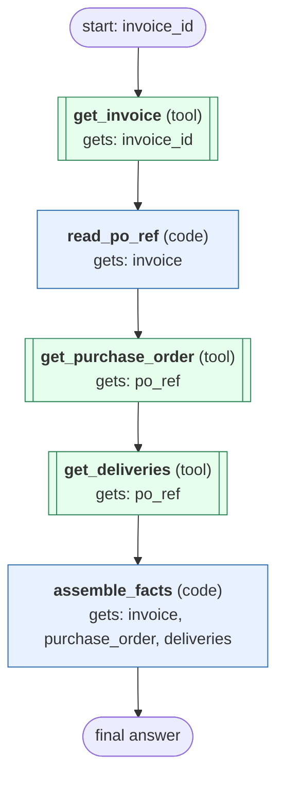

# collect-invoice-raw-facts workflow (generated directly from session 'Collect invoice T01-INV-04 raw facts')

Collect the raw facts for one invoice (invoice header, lines, tax, total) and its purchase order and delivery receipt lines, copied exactly as the invoice tools return them.

## What each node receives

| Node | Type | Receives (only this) | Tools allowed | Produces | Checks |
|---|---|---|---|---|---|
| get_invoice | tool | invoice_id | get_invoice | invoice | non_empty |
| read_po_ref | code | invoice | - | po_ref | non_empty |
| get_purchase_order | tool | po_ref | get_purchase_order | purchase_order | non_empty |
| get_deliveries | tool | po_ref | get_deliveries | deliveries | non_empty |
| assemble_facts | code | invoice, purchase_order, deliveries | - | facts | non_empty, po_not_found_handled, grounded_in_tool_results |
