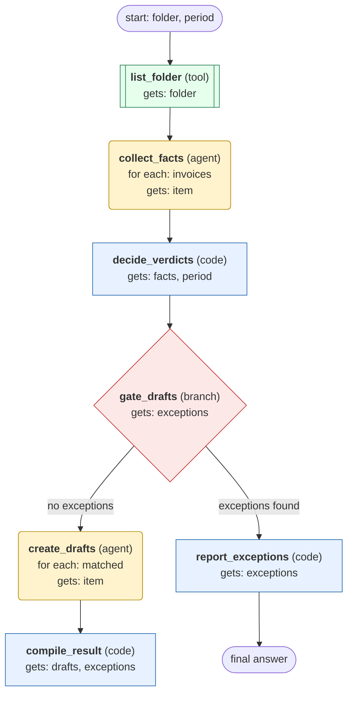

# invoice-matching-workflow workflow (generated directly from session 'Process F01 invoice matching for 2026-10 #3')

Match the supplier invoices in one mailbox folder for one period against their purchase orders and goods receipts, then create a draft bill for each clean match. Stop and report if any invoice has an exception.

## What each node receives

| Node | Type | Receives (only this) | Tools allowed | Produces | Checks |
|---|---|---|---|---|---|
| list_folder | tool | folder | list_invoices | invoices | non_empty, grounded_in_tool_results |
| collect_facts | agent | one item of `invoices` | get_invoice, get_purchase_order, get_deliveries | facts | schema, grounded_in_tool_results |
| decide_verdicts | code | facts, period | - | verdicts, matched, exceptions | verdicts_cover_all_invoices |
| gate_drafts | branch | exceptions | - |  | ready_for_drafts |
| create_drafts | agent | one item of `matched` | create_draft_bill, get_draft_bill | drafts | schema, grounded_in_tool_results, draft_matches_invoice |
| compile_result | code | drafts, exceptions | - | result | non_empty |
| report_exceptions | code | exceptions | - | gap_report | non_empty |
