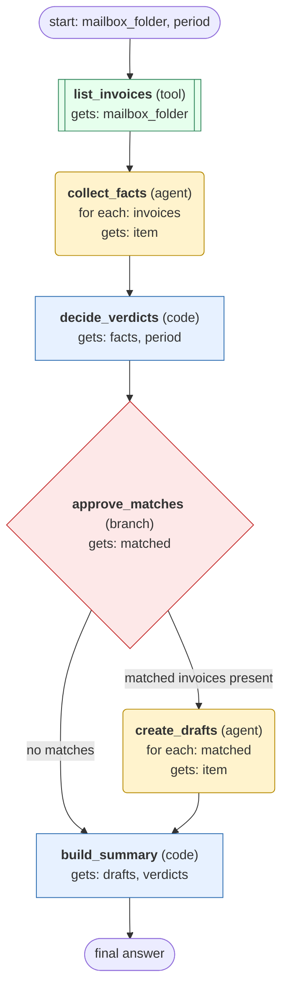

# invoice-mailbox-match-and-draft workflow (generated directly from session 'Process F02 invoice mailbox for 2026-10')

For one mailbox folder and period, collect each invoice's facts, match it against its purchase order and deliveries, and create a draft bill for each clean match.

## What each node receives

| Node | Type | Receives (only this) | Tools allowed | Produces | Checks |
|---|---|---|---|---|---|
| list_invoices | tool | mailbox_folder | list_invoices | invoices | non_empty |
| collect_facts | agent | one item of `invoices` | get_invoice, get_purchase_order, get_deliveries | facts | schema, grounded_in_tool_results |
| decide_verdicts | code | facts, period | - | verdicts, matched | non_empty, verdict_rules_applied, every_invoice_has_verdict |
| approve_matches | branch | matched | - |  | - |
| create_drafts | agent | one item of `matched` | create_draft_bill, get_draft_bill | drafts | schema, grounded_in_tool_results, draft_readback_matches |
| build_summary | code | drafts, verdicts | - | result | non_empty, every_invoice_accounted_for |
