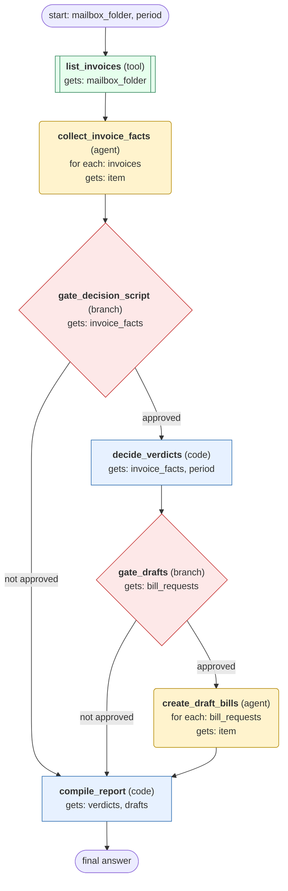

# process-invoice-mailbox-folder workflow (generated directly from session 'Process F03 invoice mailbox for 2026-10')

List the invoices in one mailbox folder, collect each invoice's purchase order and deliveries, classify them for a period, create draft bills for the clean matches after approval, and report matches and exceptions.

## What each node receives

| Node | Type | Receives (only this) | Tools allowed | Produces | Checks |
|---|---|---|---|---|---|
| list_invoices | tool | mailbox_folder | list_invoices | invoices | non_empty, grounded_in_tool_results |
| collect_invoice_facts | agent | one item of `invoices` | get_invoice, get_purchase_order, get_deliveries | invoice_facts | schema, grounded_in_tool_results |
| gate_decision_script | branch | invoice_facts | - |  | user_approves_step |
| decide_verdicts | code | invoice_facts, period | - | verdicts, bill_requests | verdicts_cover_every_invoice |
| gate_drafts | branch | bill_requests | - |  | user_approves_step |
| create_draft_bills | agent | one item of `bill_requests` | create_draft_bill, get_draft_bill | drafts | schema, grounded_in_tool_results, draft_read_back_matches |
| compile_report | code | verdicts, drafts | - | final_summary | non_empty |
