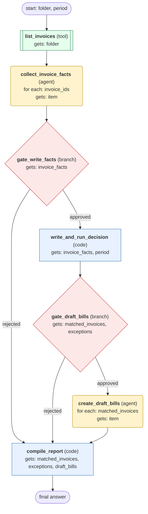

# invoice-matching-workflow workflow (generated directly from session 'Process F04 invoices for 2026-10 #3')

Match each supplier invoice in a mailbox folder for a given month to its purchase order and delivery records, decide ok or exception per invoice, and create draft bills for the matched ones after user approval.

## What each node receives

| Node | Type | Receives (only this) | Tools allowed | Produces | Checks |
|---|---|---|---|---|---|
| list_invoices | tool | folder | list_invoices | invoice_ids | non_empty, environment_probe_ok |
| collect_invoice_facts | agent | one item of `invoice_ids` | get_invoice, get_purchase_order, get_deliveries | invoice_facts | schema, grounded_in_tool_results |
| gate_write_facts | branch | invoice_facts | - |  | user_approval_recorded |
| write_and_run_decision | code | invoice_facts, period | - | verdicts, matched_invoices, exceptions | one_verdict_per_invoice |
| gate_draft_bills | branch | matched_invoices, exceptions | - |  | user_approval_recorded |
| create_draft_bills | agent | one item of `matched_invoices` | create_draft_bill, get_draft_bill | draft_bills | schema, grounded_in_tool_results, draft_matches_invoice |
| compile_report | code | matched_invoices, exceptions, draft_bills | - | final_result | every_invoice_accounted_for |
