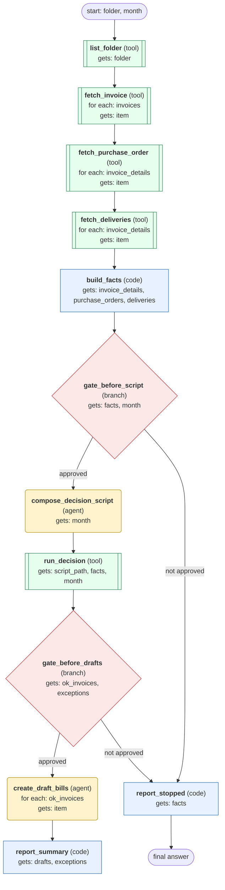

# process-mailbox-invoices-for-month workflow (generated directly from session 'Process F05 invoices for 2026-10 #3')

Match each supplier invoice in a mailbox folder to its purchase order and deliveries for a given month, reject invoices that fail the rules, and create draft bills for the ones that pass.

## What each node receives

| Node | Type | Receives (only this) | Tools allowed | Produces | Checks |
|---|---|---|---|---|---|
| list_folder | tool | folder | list_invoices | invoices | non_empty |
| fetch_invoice | tool | one item of `invoices` | get_invoice | invoice_details | non_empty |
| fetch_purchase_order | tool | one item of `invoice_details` | get_purchase_order | purchase_orders | non_empty |
| fetch_deliveries | tool | one item of `invoice_details` | get_deliveries | deliveries | non_empty |
| build_facts | code | invoice_details, purchase_orders, deliveries | - | facts | every_invoice_has_facts |
| gate_before_script | branch | facts, month | - |  | user_approves_run |
| compose_decision_script | agent | month | write_file | script_path | schema, non_empty, script_implements_rules |
| run_decision | tool | script_path, facts, month | terminal | ok_invoices, exceptions | verdicts_cover_all_invoices |
| gate_before_drafts | branch | ok_invoices, exceptions | - |  | user_approves_drafts |
| create_draft_bills | agent | one item of `ok_invoices` | create_draft_bill, get_draft_bill | drafts | schema, grounded_in_tool_results |
| report_summary | code | drafts, exceptions | - | summary | every_invoice_accounted_for |
| report_stopped | code | facts | - | stop_message | non_empty |
