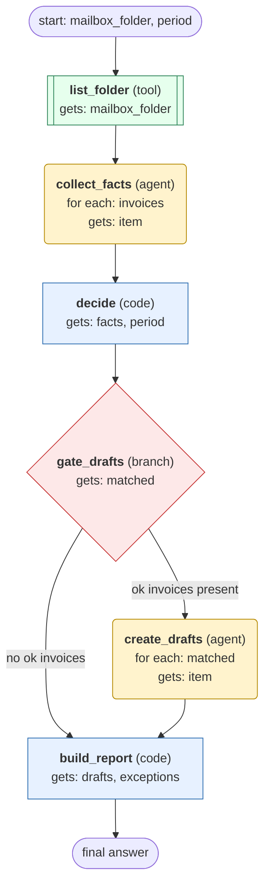

# process-mailbox-invoices-to-draft-bills workflow (generated directly from session 'Process F06 invoices for 2026-10 #4')

For one mailbox folder and period, check each supplier invoice against its purchase order and deliveries, create draft bills for invoices that pass, and report matches and exceptions.

## What each node receives

| Node | Type | Receives (only this) | Tools allowed | Produces | Checks |
|---|---|---|---|---|---|
| list_folder | tool | mailbox_folder | list_invoices | invoices | non_empty |
| collect_facts | agent | one item of `invoices` | get_invoice, get_purchase_order, get_deliveries | facts | schema, grounded_in_tool_results |
| decide | code | facts, period | - | verdicts, matched, exceptions | verdicts_cover_all_invoices, every_invoice_accounted_for |
| gate_drafts | branch | matched | - |  | ok_only_matches, ok_invoices_present |
| create_drafts | agent | one item of `matched` | create_draft_bill, get_draft_bill | drafts | schema, grounded_in_tool_results, drafts_match_matched |
| build_report | code | drafts, exceptions | - | final_report | non_empty, every_invoice_accounted_for |
