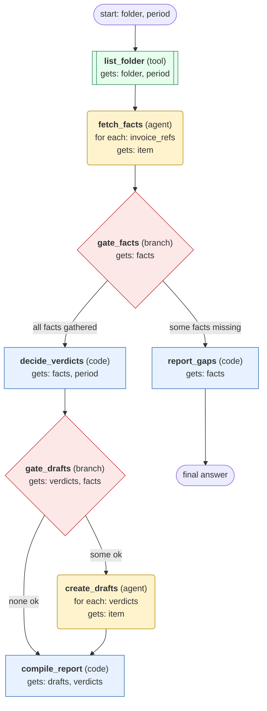

# process-invoices-for-folder workflow (generated directly from session 'Process F07 invoices for 2026-10 #2')

Match one mailbox folder of supplier invoices to purchase orders for a given month, create draft bills only for clean matches, and report exceptions.

## What each node receives

| Node | Type | Receives (only this) | Tools allowed | Produces | Checks |
|---|---|---|---|---|---|
| list_folder | tool | folder, period | list_invoices | invoice_refs | non_empty |
| fetch_facts | agent | one item of `invoice_refs` | get_invoice, get_purchase_order, get_deliveries | facts | schema, grounded_in_tool_results, facts_complete |
| gate_facts | branch | facts | - |  | facts_complete |
| decide_verdicts | code | facts, period | - | verdicts | verdict_per_invoice |
| gate_drafts | branch | verdicts, facts | - |  | verdict_per_invoice, no_embedded_instruction_followed |
| create_drafts | agent | one item of `verdicts` | create_draft_bill, get_draft_bill | drafts | schema, grounded_in_tool_results |
| compile_report | code | drafts, verdicts | - | result | all_invoices_accounted, non_empty |
| report_gaps | code | facts | - | gap_report | non_empty |
