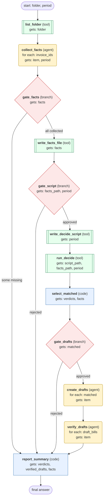

# invoice-matching-f08 workflow (generated directly from session 'Process F08 invoice matching for 2026-10')

Match one mailbox folder of supplier invoices to purchase orders for a given period, with approval gates before any file write, script run, or draft bill creation, then report matched and exception invoices.

## What each node receives

| Node | Type | Receives (only this) | Tools allowed | Produces | Checks |
|---|---|---|---|---|---|
| list_folder | tool | folder | list_invoices | invoice_ids, invoice_headers | non_empty, grounded_in_tool_results |
| collect_facts | agent | one item of `invoice_ids` + period | get_invoice, get_purchase_order, get_deliveries | facts | schema, grounded_in_tool_results, every_invoice_has_facts |
| gate_facts | branch | facts | - |  | - |
| write_facts_file | tool | facts | write_file | facts_path | non_empty, facts_file_matches_facts |
| gate_script | branch | facts_path, period | - |  | user_approves_decide_script |
| write_decide_script | tool | period | terminal | script_path | non_empty |
| run_decide | tool | script_path, facts_path, period | terminal | verdicts | non_empty, verdicts_cover_all_invoices |
| select_matched | code | verdicts, facts | - | matched | verdicts_cover_all_invoices |
| gate_drafts | branch | matched | - |  | user_approves_drafts |
| create_drafts | agent | one item of `matched` | create_draft_bill | draft_bills | schema, grounded_in_tool_results, every_matched_has_draft |
| verify_drafts | agent | one item of `draft_bills` | get_draft_bill | verified_drafts | schema, grounded_in_tool_results, draft_matches_request |
| report_summary | code | verdicts, verified_drafts, facts | - | final_report | final_report_covers_all_invoices, non_empty |
