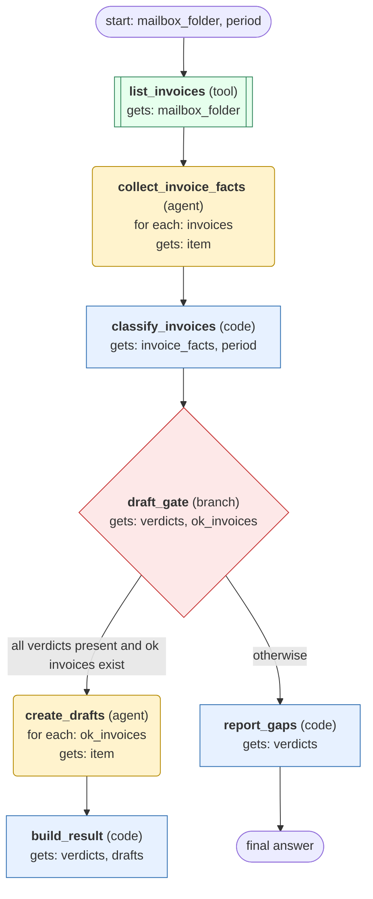

# process-mailbox-invoices-to-draft-bills workflow (generated directly from session 'Process F09 invoices for 2026-10 #4')

Match each supplier invoice in a mailbox folder to its purchase order and delivery records, classify it, and create draft bills for the invoices that pass.

## What each node receives

| Node | Type | Receives (only this) | Tools allowed | Produces | Checks |
|---|---|---|---|---|---|
| list_invoices | tool | mailbox_folder | list_invoices | invoices | non_empty |
| collect_invoice_facts | agent | one item of `invoices` | get_invoice, get_purchase_order, get_deliveries | invoice_facts | schema, grounded_in_tool_results |
| classify_invoices | code | invoice_facts, period | - | verdicts, ok_invoices | verdict_for_every_invoice |
| draft_gate | branch | verdicts, ok_invoices | - |  | verdict_for_every_invoice |
| create_drafts | agent | one item of `ok_invoices` | create_draft_bill, get_draft_bill | drafts | schema, grounded_in_tool_results, draft_read_back_matches |
| build_result | code | verdicts, drafts | - | result | non_empty |
| report_gaps | code | verdicts | - | gap_report | non_empty |
