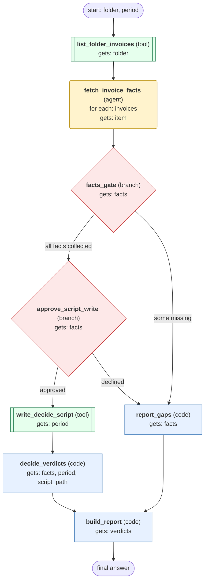

# process-invoice-mailbox-folder workflow (generated directly from session 'Process invoice mailbox folder F10 2026-10')

Match one mailbox folder of supplier invoices for a given period against purchase orders and deliveries, then produce a verdict per invoice and a summary report.

## What each node receives

| Node | Type | Receives (only this) | Tools allowed | Produces | Checks |
|---|---|---|---|---|---|
| list_folder_invoices | tool | folder | list_invoices | invoices | non_empty |
| fetch_invoice_facts | agent | one item of `invoices` | get_invoice, get_purchase_order, get_deliveries | facts | schema, grounded_in_tool_results, no_invented_values |
| facts_gate | branch | facts | - |  | all_items_collected |
| approve_script_write | branch | facts | - |  | user_approves_write |
| write_decide_script | tool | period | write_file | script_path | non_empty |
| decide_verdicts | code | facts, period, script_path | - | verdicts | verdict_per_invoice |
| report_gaps | code | facts | - | gap_report | non_empty |
| build_report | code | verdicts | - | report | report_has_all_verdicts |
